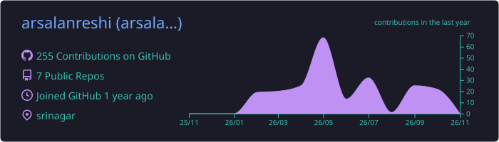
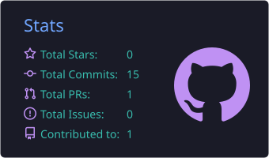
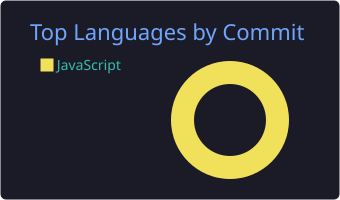

<!-- Header -->
<div align="center">


<a href="https://www.arsalanreshi.dev/">
  
</a>

<p>
  <a href="https://www.arsalanreshi.dev/"></a>
  <!-- Replace YOUR_HANDLE with your real usernames, or delete the line -->
  <a href="https://www.linkedin.com/in/arsalan-reshi-5862a5346?utm_source=share_via&utm_content=profile&utm_medium=member_ios"></a>
  <a href="https://x.com/YOUR_HANDLE"></a>
</p>


</div>

---

## 👋 About me

```ts
const arsalan = {
  role: "Frontend Developer",
  location: "Srinagar, Kashmir ",
  focus: ["React.js", "React Native", "Next.js", "TypeScript"],
  currentlyBuilding: "PydhalChalo 📱",
  loves: ["clean code", "great UX", "shipping products"],
  askMeAbout: ["UI architecture", "mobile apps", "performance"],
};
```

- 🔭 Building modern web & mobile experiences end to end
- 🌱 Currently learning: _add what you're learning_
- ⚡ Fun fact: _add one_

## 🛠️ Tech stack

<p align="center">
  
  <br/><br/>
  
</p>

## 🚀 Featured work

| Project | What it is | Stack |
| --- | --- | --- |
| [**PydhalChalo**](https://github.com/muzad79/PydhalChalo) | Mobile app live on Google Play | React Native |
| [**Portfolio**](https://github.com/arsalanreshi/portfolio) | My personal site — [arsalanreshi.dev](https://www.arsalanreshi.dev/) | Next.js · TypeScript |
| [**mobile-store**](https://github.com/arsalanreshi/mobile-store) | E-commerce storefront | JavaScript |

## 📊 GitHub stats

<div align="center">







</div>

## 🐍 Contribution snake

<picture>
  <source media="(prefers-color-scheme: dark)" srcset="https://raw.githubusercontent.com/arsalanreshi/arsalanreshi/output/github-snake-dark.svg" />
  
</picture>

<div align="center">


</div>
